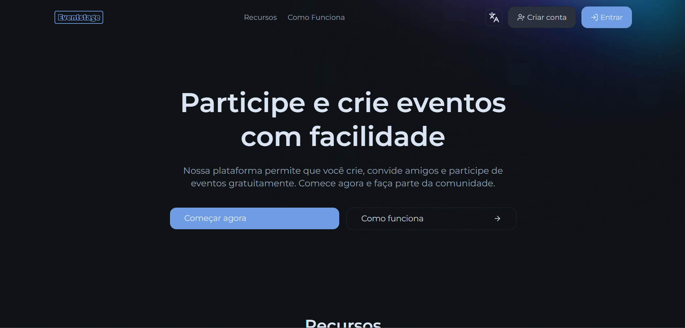
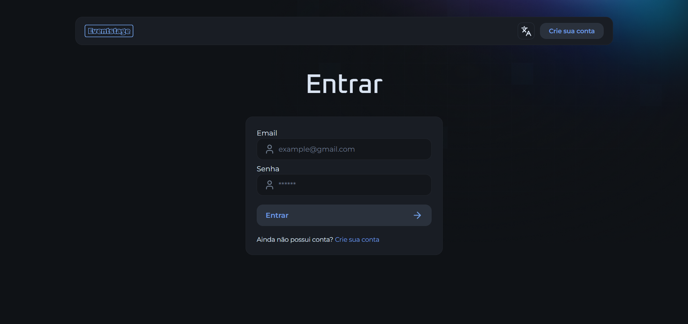
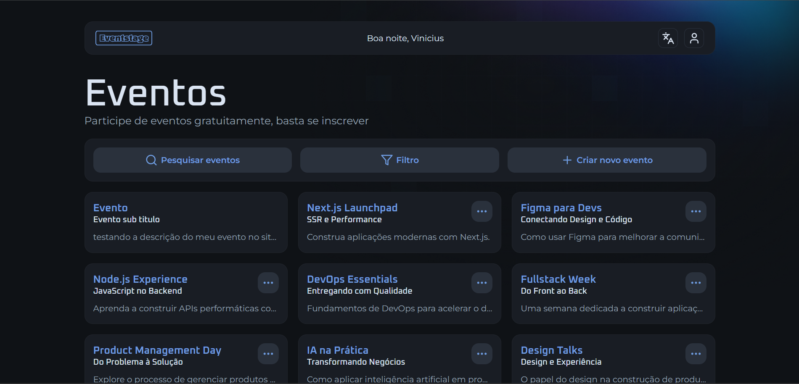
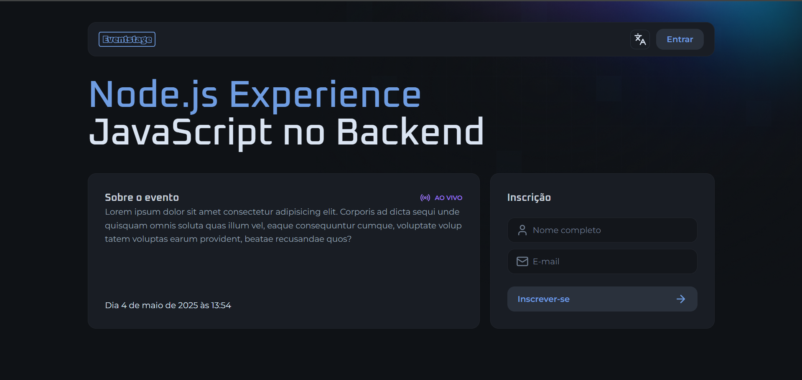
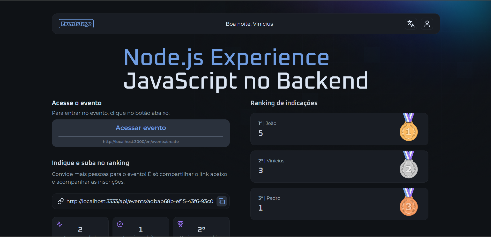
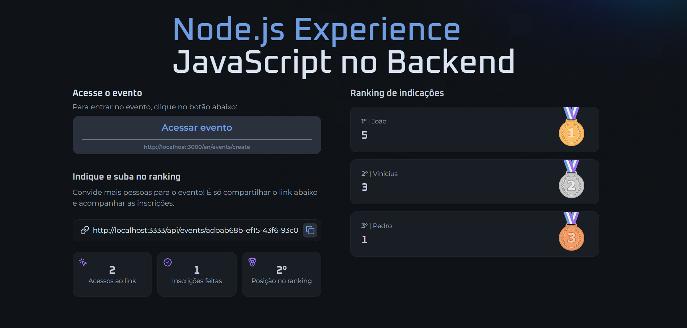

<p align="center">
  
</p>

<p align="center">
  Plataforma de eventos baseada na NLW Journey da <a href="https://www.rocketseat.com.br/">Rocketseat</a>, <strong>expandida</strong> e <strong>reestruturada</strong>.
</p>

## Sobre o Projeto

**Eventstage** é uma plataforma de eventos que teve como ponto de partida um projeto da NLW Journey da [Rocketseat](https://www.rocketseat.com.br/). A ideia original consistia em uma aplicação simples com apenas duas páginas, voltada para praticar conceitos de frontend.

No entanto, este projeto foi além da proposta inicial. A partir da base fornecida pela Rocketseat, o Eventstage foi **reestruturado e expandido** para se tornar uma plataforma mais completa e funcional. Foram adicionadas novas funcionalidades, melhorias na interface e uma proposta de experiência mais robusta para o usuário.

Essa evolução do projeto visa não apenas praticar o conteúdo aprendido, mas também demonstrar iniciativa em aplicar melhorias, criar novas ideias e simular uma aplicação real com potencial de uso.

---

## 📸 Screenshots

<p align="center">
  
  
  
</p>

<p align="center">
  
  
  
</p>

## ✨ Funcionalidades

Com o Eventstage, é possível:

- Criar eventos personalizados  
- Participar de eventos criados por outros usuários  
- Convidar pessoas através de links únicos de convite  
- Subir no ranking do evento conforme mais pessoas se inscrevem usando seu link  

---

> ⚠️ **Este repositório contém apenas o frontend da aplicação.**  
> O repositório do backend pode ser acessado [aqui](https://github.com/viniciusrvcruz/eventstage-backend).

---

## 🚀 Instalação

Siga os passos abaixo para clonar o repositório, instalar as dependências e iniciar o projeto localmente:

```bash
# Clone o repositório
git clone https://github.com/viniciusrvcruz/eventstage-frontend.git

# Acesse a pasta do projeto
cd eventstage-frontend

# Instale as dependências
npm install
# ou
yarn install
```

### ⚙️ Configuração das Variáveis de Ambiente

Este projeto utiliza variáveis de ambiente para se comunicar com o backend e configurar alguns valores do frontend. Para isso:

1. Copie o arquivo `.env.example` e renomeie para `.env`:

```bash
cp .env.example .env

```

2. Abra o arquivo .env e atualize os valores conforme necessário:

```env
NEXT_PUBLIC_API_URL=http://localhost:3333/api
NEXT_PUBLIC_WEB_ADDRESS=http://localhost:3000
```

> Certifique-se de que o backend esteja rodando na mesma URL/porta especificada em `NEXT_PUBLIC_API_URL`.

---

### ▶️ Rodando o Projeto

Após instalar as dependências e configurar as variáveis de ambiente, inicie o servidor de desenvolvimento:

```bash
npm run dev
# ou
yarn dev
```


## 📦 Tecnologias e Principais Dependências

Este projeto foi desenvolvido com **Next.js** e utiliza diversas bibliotecas modernas para melhorar a experiência do usuário e a produtividade no desenvolvimento. Aqui estão algumas das mais importantes:

- **Next.js 15** – Framework React para renderização híbrida (SSR/SSG), roteamento e otimizações.
- **React 19** – Biblioteca principal para construção da interface.
- **Tailwind CSS 4** – Framework utilitário para estilização rápida e responsiva.
- **React Hook Form** – Gerenciamento de formulários de forma performática.
- **Zod** – Validação de schemas tipada para integração com formulários.
- **Radix UI** – Componentes acessíveis e estilizados (Dropdown, Select).
- **Next Intl** – Internacionalização e tradução no Next.js.
- **Lucide React** – Ícones modernos baseados em SVG.
- **React Toastify** – Notificações personalizáveis.
- **Biome** – Linter e formatter rápido, substituindo ESLint/Prettier.

---

## 🗂️ Estrutura do Projeto

O projeto segue uma estrutura modular e escalável, aproveitando a abordagem de rotas e pastas do **App Router** do Next.js 13+. Abaixo, uma visão geral dos principais diretórios:

```txt
src
├── app/                  # Pasta principal de rotas (App Router)
│   └── [locale]/         # Suporte à internacionalização por locale
│       ├── (private)/    # Rotas protegidas para usuários autenticados
│       │   ├── events/   # Páginas relacionadas a eventos (listar, criar, editar, detalhes)
│       │   └── support/  # Página de suporte
│       ├── (public)/     # Rotas públicas (login, registro, etc.)
│       ├── layout.tsx    # Layout raiz por locale
│       └── page.tsx      # Página inicial
├── assets/               # Arquivos estáticos (ícones, imagens)
├── components/           # Componentes reutilizáveis da interface
│   └── ui/               # Subconjunto de componentes de UI
├── constants/            # Constantes usadas no app
├── env.ts                # Tipagem das variáveis de ambiente
├── i18n/                 # Arquivos relacionados a internacionalização
├── lib/                  # Funções utilitárias e helpers de API
├── middleware.ts         # Middleware para rotas (ex: autenticação, locale)
├── services/             # Camada de serviços para acesso à API
├── types/                # Tipagens TypeScript para os dados da aplicação
└── utils/                # Funções auxiliares diversas

```
---

## 📦 Variáveis de ambiente (.env)

```env
NEXT_PUBLIC_API_URL=http://localhost:3333/api
NEXT_PUBLIC_WEB_ADDRESS=http://localhost:3000
```
---

## 📝 License

Licensed under the MIT License.

